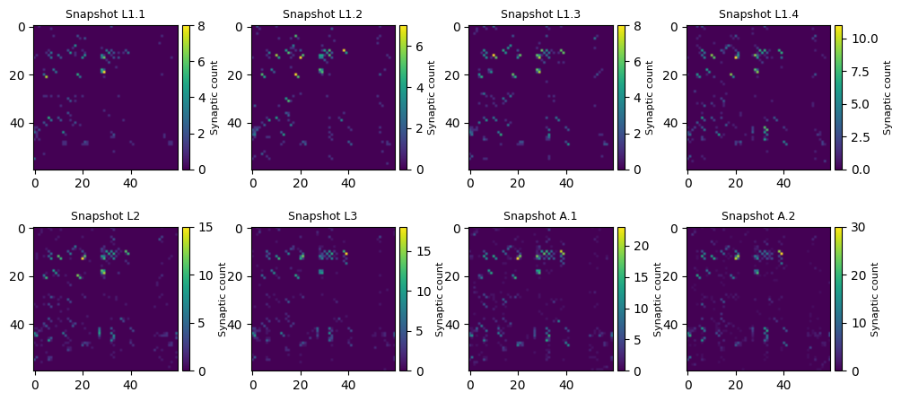
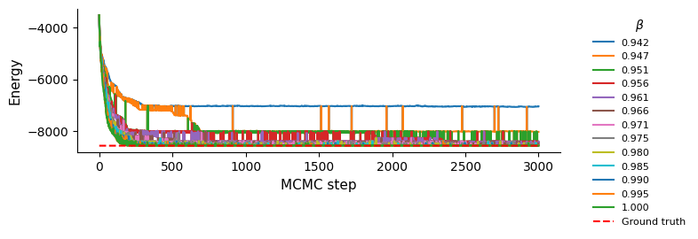
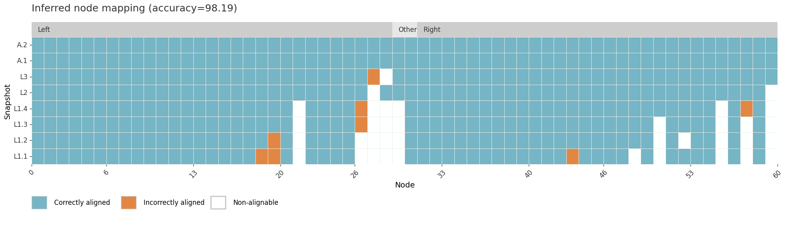
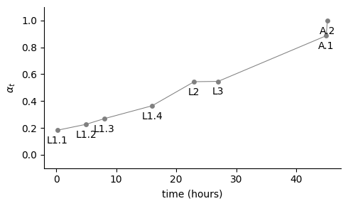
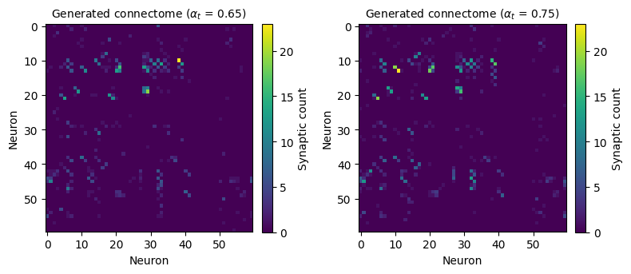

# Probabilistic alignment of evolving multigraphs and weighted networks

This repository contains the code accompanying the paper:

> Bel-Bordes, G., Lázaro, T., Guimerà, R., & Sales-Pardo, M.
> **Probabilistic alignment of evolving multigraphs and weighted networks.**
> [...]

## Installation

Clone the repository:

```bash
git clone https://github.com/gemmabb/Aligner_evonets.git
cd Aligner_evonets
```

We recommend creating a dedicated Python environment. For example, using Python 3.10:

```bash
python3.10 -m venv evoalign
source evoalign/bin/activate
```

Install the package and its dependencies:

```bash
python -m pip install -e .
```

And you are ready to go!

If one wishes to reproduce the exact same environment as in the original paper, the requirements are in `requirements.txt`.


## Data

The datasets used in the paper are publicly available datasets that are not owned or distributed by the authors. Therefore, the original datasets are not included in this repository.

For each dataset, `data/raw/` contains a README with instructions for downloading the corresponding original data and placing it in the appropriate directory.

The repository also provides tutorials showing how to process the downloaded data into the format required by our method (see `tutorials/data/`).

For convenience, we provide reduced versions of the connectome matrices  in `data/processed/`. These reduced matrices are intended as example data, allowing the tutorial to be run without downloading the original datasets.

## Tutorial

The accompanying tutorial demonstrates the main functionalities of the package:

* Aligning multiple snapshots of an evolving multigraph or weighted network.
* Analysing the resulting alignments.
* Generating unobserved network snapshots.

The tutorial can be run directly using the example matrices provided in `data/processed/celegans/`.

(For the full datasets, follow the dataset-specific instructions in `data/raw/` and then use the provided data-processing tutorials.)

## Repository structure

```text
alignment_evolving_multigraphs/
├── data/
│   ├── raw/          # Instructions for downloading original datasets
│   └── processed/    
│       └── celegans/ # Reduced matrices of connectomes to run the tutorial
├── src/
│   └── aligner/      # Package source code
├── requirements.txt  # Tested package versions
├── pyproject.toml    # Package configuration
└── README.md
```

## Citation

If you use this code, please cite:

> Bel-Bordes, G., Lázaro, T., Guimerà, R., & Sales-Pardo, M.
> **Probabilistic alignment of evolving multigraphs and weighted networks.**
> [...]

## License

This project is licensed under the [GNU General Public License v3.0 or later](LICENSE) — a strong copyleft open-source license that allows you to use, modify, and redistribute the code, provided that distributed derivative works remain under the same license.

[](https://www.gnu.org/licenses/gpl-3.0.html)

### You are free to:

* **Use** — use the software for private, academic, commercial, or other purposes
* **Modify** — adapt, improve, and create derivative works
* **Distribute** — share and redistribute the original or modified code
* **Share improvements** — distribute modified versions under the terms of the GPL

### Under the following terms:

* **Copyleft** — distributed derivative works must be licensed under the GPL
* **Source code** — when distributing covered binaries, the corresponding source code must be made available as required by the GPL
* **License notice** — retain the copyright and license notices
* **Same freedoms** — recipients must receive the same freedoms to use, modify, and redistribute the code

See the [GNU General Public License v3.0](https://www.gnu.org/licenses/gpl-3.0.html) for the full license terms.


_________________________________

# TUTORIAL: main functionalities

Same as `tutorials/0_tutorial.ipynb`.


```python
from aligner.networksHandling import helper as helper_networks
from aligner.poissonAlignment import helper as helper_poisson
from aligner.montecarlo import helper as helper_montecarlo
from aligner.analysis import helper as helper_analysis
```


```python
import numpy as np
import pandas as pd
import matplotlib.pyplot as plt
import pickle
```

## 1. Loading and preparing the data

We now load the data. In this example, we will consider a subset of the *C. elegans* connectomes$^{1}$.  

We will perform a group-guided alignment by considering the spatial location of the neurons (left–right, in the case of bilateral neurons). We use a reduced version of the connectomes containing only 60 neurons (we provide the dataset, but more details are in `reproducibility_paper/data_processing_celegans.ipynb`).  

Data required:
* `A`: adjacency matrices of the snapshots to be aligned (size $T \times N \times N$), where $T$ is the number of snapshots and $N$ is the number of nodes.  
* `groups`: array indicating the group membership of each neuron (in the same order as they appear in `A`). If one desires to do the alignment without groups, set `groups = None`.

$^{1}$ Witvliet, D. *et al.* Connectomes across development reveal principles of brain maturation. *Nature* **596**, 257–261 (2021). [https://doi.org/10.1038/s41586-021-03778-8](https://doi.org/10.1038/s41586-021-03778-8)


```python
#Adjacency matrices:
labels = ["L1.1", "L1.2", "L1.3", "L1.4", "L2", "L3", "A.1", "A.2"]

A = helper_networks.load_networks(data_folder="/data/celegans/", 
                                  net_ids=[l for l in range(len(labels))], file_prefix="reduced_")

T, N, N = A.shape
```


```python
## Plot adjacency matrices:
fig, axes = plt.subplots(2, 4, figsize=(12, 5), gridspec_kw={'wspace':0.2, 'hspace':0.4})

for i, ax in enumerate(axes.flat):
    im = ax.imshow(A[i]); ax.set_title(f"Snapshot {labels[i]}", fontsize=9)
    from mpl_toolkits.axes_grid1 import make_axes_locatable
    divider = make_axes_locatable(ax); cax = divider.append_axes("right", size="5%", pad=0.05)
    cbar = fig.colorbar(im, cax=cax); cbar.set_label("Synaptic count", fontsize=8)

plt.show()
```


    

    


```python
#Groups:
neuron_metadata = pd.read_csv("data/celegans/reduced_neuron_metadata.csv", index_col=0) 
groups = np.array(neuron_metadata["location"])
print(groups)
```

    ['Left' 'Right' 'Left' 'Right' 'Left' 'Right' 'Left' 'Right' 'Left'
     'Right' 'Left' 'Right' 'Left' 'Right' 'Left' 'Right' 'Left' 'Right'
     'Left' 'Right' 'Left' 'Right' 'Other' 'Left' 'Right' 'Left' 'Right'
     'Right' 'Left' 'Right' 'Left' 'Right' 'Left' 'Right' 'Left' 'Right'
     'Left' 'Right' 'Left' 'Right' 'Left' 'Right' 'Left' 'Right' 'Left'
     'Right' 'Left' 'Right' 'Left' 'Right' 'Left' 'Right' 'Left' 'Right'
     'Left' 'Right' 'Left' 'Right' 'Left' 'Other']


## 2. Sampling alignments

Once the data are loaded, we proceed to run Monte Carlo (MC) simulations to sample the space of alignments.  
In practice, we sample pairs of blueprint–node mappings, which are formally defined as permutations for each snapshot.

Here, we run one MC simulation with **parallel tempering** — meaning that several replicas of the system are simulated at different temperatures (recall that $\beta = 1 / \text{Temperature}$).  
In a full analysis, we typically perform five independent runs (see `1_alignment_networks.ipynb` for reference).  
Since we are working with connectomes and aim to preserve the left–right symmetry, we use a **group-guided alignment**.

We must define the following parameters:

* `MCsteps`: number of Monte Carlo steps.  
* `start_sampling`: MC step from which to start storing alignments at temperature 1 (i.e., those used in the ensemble).  
* `freq_sampling`: number of steps between two consecutive samples of the ensemble.  
* `betas`: inverse temperatures corresponding to each parallel tempering replica.  
* `initial_P`: initial permutation (node mapping). We initialize it by ordering nodes according to their strength within each snapshot.  


```python
#Parameters of the Monte Carlo:
MCsteps = 3000
start_sampling = 1500
freq_sampling = 1

## Parallel tempering:
betas = np.array([1.005**n for n in range(-12,1)])
```


```python
#Initial permutation of the snapshots:
initial_P = helper_montecarlo.initial_permutation_groups(A, groups) #nodes are ordered by strength
```

    Groups: ['Left' 'Other' 'Right']
    Group boundary array: [ 0 29 31 60]


```python
Esweeps_r, samples, groundState, MCacceptance_rate = helper_montecarlo.sampling_poisson_groups(A=A, 
    P=initial_P, betas=betas, S=MCsteps, sampleFrom=start_sampling, sampleFreq=freq_sampling, 
    groups=groups, filesave=None)
```

    Sweeps: 100%|█████████████████████████████████████████████████████████████████████████████████████████████████████████████████████████████████████████████| 3000/3000 [03:09<00:00, 15.81it/s]

    Replica with minimum energy: 3


    


In case one desires to run the MC **without group constraints**, the following changes must be made:

* Instead of `helper_montecarlo.initial_permutation(..., groups=groups)`, use `helper_montecarlo.initial_permutation(...)` — same arguments but without the `groups` parameter.  
* Instead of `helper_montecarlo.sampling_poisson(..., groups=groups)`, use `helper_montecarlo.sampling_poisson(...)` — same arguments but without the `groups` parameter.


## 3. Analyzing the alignment results

After sampling alignments with the MC procedure, we analyze the results.  
Specifically, we are interested in the **mapping of nodes across snapshots**.

In this section, we will:

1. Visualize the MC process by plotting the **alignment energy** over the MC steps and comparing it to the energy of the **ground-truth alignment**.  
2. Compare the **inferred node mappings** (obtained from the ensemble of sampled permutations) to the **ground-truth mappings**.


```python
#Ground truth energy:
gtP = np.array([[n for n in range (N)] for t in range(T)]) #GT permutation is the same permutation for each snapshot (bc nodes are originally ordered in the same way)
Egt = helper_poisson.calculateEnergy_total(A, gtP, helper_poisson.get_Salpha(A), N, T)
print(f"Ground Truth Energy = {Egt}")

fig, ax = plt.subplots(figsize=(8, 2.5))
for b, beta in enumerate(betas):
    ax.plot(Esweeps_r[b], label=f"{beta:.3f}")
ax.plot([Egt] * len(Esweeps_r[b]), 'r--', label="Ground truth")
ax.set_xlabel("MCMC step", fontsize=11); ax.set_ylabel("Energy", fontsize=11)
ax.spines['top'].set_visible(False); ax.spines['right'].set_visible(False)
ax.legend(title=r"$\beta$", fontsize=8, frameon=False, bbox_to_anchor=(1.05, 1), loc='upper left')
plt.tight_layout()
plt.show()
```

    Ground Truth Energy = -8573.74925771809


    

    


```python
#Inferred node mapping:
ensemble = samples
ensemble_node_mapping = helper_analysis.infer_node_mapping(ensemble)
ensemble_node_mapping = helper_analysis.mark_empty_nodes(ensemble_node_mapping, A)
ensemble_node_mapping = helper_analysis.order_node_mapping(ensemble_node_mapping, A, groups) #to sort nodes by desc strngth in the densest snapshot (in this case, A.2)

accuracy = helper_analysis.compute_accuracy(ensemble_node_mapping) #disregarding non-alignable nodes
helper_analysis.show_alignment(ensemble_node_mapping, N, T, True, True, labels, 
                               f"Inferred node mapping (accuracy={100*accuracy:.2f})", groups); #groups=None if we have no groups
```

    Groups: ['Left' 'Other' 'Right']
    Group boundary array: [ 0 29 31 60]


    

    


## 3. Generating unobserved snapshots

One key contribution of our approach, besides the alignment, is the ability to accurately generate unobserved snapshots. For this, we first infer the blueprint from the ensemble of alignments.

Since the developmental parameter ($\alpha^t$) shows a linear relationship with the original timestep, as shown in the figure below, we can generate the connectomes at two intermediate states between L3 and A.1 with $\alpha^t \approx 0.65$ and $0.75$, for example.


```python
#See relationship between alpha and real time step:
alpha_values = helper_poisson.get_alpha(A, helper_poisson.get_ST(A))
time_values = [ 0.2,  5. ,  8. , 16. , 23. , 27. , 45. , 45.2] #from Wivliet paper (in hours)

plt.figure(figsize=(5, 3)); plt.plot(time_values, alpha_values, color='grey', lw=0.75); plt.scatter(time_values, alpha_values, color='grey', s=25, linewidths=0)
plt.ylim([-0.1, 1.1]); plt.xlabel("time (hours)"); plt.ylabel(r"$\alpha_t$ "); 
for t, alpha, label in zip(time_values, alpha_values, labels):
    plt.text(t, alpha - 0.1, str(label), ha='center', fontsize=10)
ax = plt.gca(); ax.spines['top'].set_visible(False); ax.spines['right'].set_visible(False)
plt.tight_layout(); plt.show()
```


    

    


```python
#Infer blueprint:
inferred_blueprint = helper_analysis.infer_blueprint(A, ensemble)
```


```python
#Select alphas of the new connectomes:
alpha_generated_connectome = [0.65, 0.75]
```


```python
#Generate:
generated_connectomes = helper_poisson.synthesize_networks(inferred_blueprint, alpha_generated_connectome)
```


```python
#See results:
M = len(generated_connectomes)
fig, axes = plt.subplots(1, M, figsize=(4*M, 4))  
for i, (ax, predA) in enumerate(zip(axes, generated_connectomes)):
    im = ax.imshow(predA, cmap='viridis')
    ax.set_title(fr"Generated connectome ($\alpha_t$ = {alpha_generated_connectome[i]:.2f})", fontsize=10)
    ax.set_xlabel("Neuron")
    ax.set_ylabel("Neuron")
    fig.colorbar(im, ax=ax, fraction=0.046, pad=0.04, label="Synaptic count")

plt.tight_layout()
plt.show()
```


    


_____________
For further analysis (for example, for comparing inferred model rates with real synaptic counts, see notebook `tutorial/2_analysis_alignment.ipynb`). And to reproduce experiments from the paper, see folder `reproducibility_paper`, with all the processed networks used in the study and the corresponding code.
